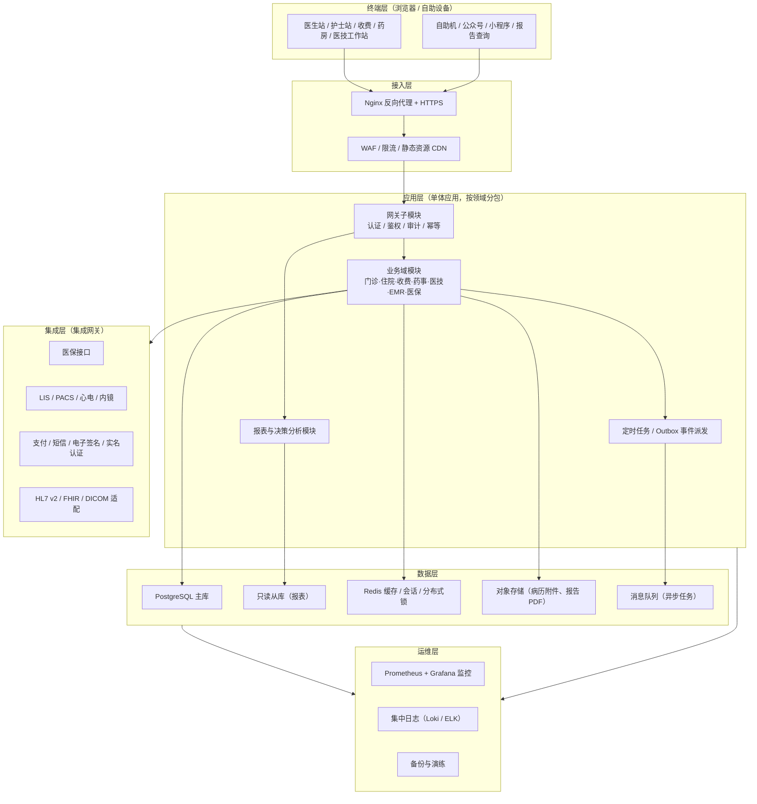
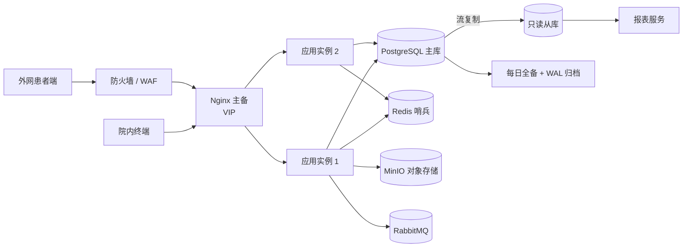

# HIS 系统架构方案（评审稿 v0.1）

| 项 | 内容 |
| --- | --- |
| 文档版本 | v0.1 评审稿 |
| 日期 | 2026-11-06 |
| 架构形态 | B/S 前后端分离 + 模块化单体 |
| 目标等级 | 电子病历应用水平 4 级 |
| 团队规模 | 1 人（全栈自研） |
| 目标用户 | 医院信息科、项目评审人、开发团队 |

---

## 1. 建设目标与范围边界

### 1.1 目标定位

面向**三级综合医院**（300–500 张床位、日门诊 2,000–5,000 人次）的核心 HIS，覆盖门急诊、住院、药事、收费、医技、电子病历、医保、报表全链路。系统按**电子病历应用水平分级评价 4 级**（全院信息共享 + 中级医疗决策支持）设计，并满足等保三级要求。

**本方案由 1 人全栈自研**，这是最强的约束条件：范围必须裁到"能交付、能维护、能过评级"的最小闭环，见第 9 节。

### 1.2 建设前提（已确认）

| 指标 | 值 | 说明 |
| --- | --- | --- |
| 医院等级 | 三级综合医院 | 需通过电子病历应用水平 4 级评价 |
| 日门诊量 | 2,000–5,000 人次 | 峰值集中在 8:00–11:00 |
| 在院床位 | 300–500 张 | 护士站并发约 100 |
| 在线并发用户 | 200–500 | 医生站 + 护士站 + 收费 + 药房 + 医技 |
| 收费类交易峰值 | 30–80 TPS | 挂号、收费、退费、发药 |
| 数据保留 | 门诊 ≥15 年、住院 ≥30 年 | 按《医疗机构病历管理规定》 |
| 部署方式 | 医院本地机房 | 患者端可另做外网出口 |
| 建设团队 | 1 人（全栈） | 决定范围裁剪与组件精简 |

### 1.3 明确不做（本期边界）

- 不做影像归档（PACS）与检验（LIS）主机系统，只做 RIS 申请、状态跟踪、报告回传与 PACS 集成；
- 不做区域全民健康平台、家庭医生、公卫；
- 不做 HRP/财务总账（只做医疗收入接口）；
- 不做医保核心系统，只做医保**接口对接**；
- 不做体检、随访、OA、互联网医院。

> 边界很重要，HIS 项目失控通常不是技术问题，而是范围蔓延。

---

## 2. 架构原则

1. **B/S 优先**：医生站、护士站用浏览器承载，通过多标签工作台 + 快捷键 + 本地草稿，逼近 C/S 操作手感，避免装客户端带来的升级地狱。
2. **模块化单体优先（Modular Monolith）**，不先上微服务。理由见第 3 节。
3. **强一致优先于最终一致**：收费、库存、床位、医嘱执行不允许"稍后一致"。跨模块一致性用**事务内 Outbox 事件**，而不是分布式事务。
4. **主数据统一**：患者、科室、人员、药品、收费项目、ICD 诊断、手术编码，全系统唯一来源。
5. **写操作全留痕**：任何影响钱、药、病历、权限的操作，必须可追溯到人、时间、终端、前后值。
6. **接口外置**：医保、LIS/PACS、自助机、支付、短信、电子签名全部经**集成网关**，业务代码不直连外部协议。
7. **可拆分但不预拆**：模块边界按"能否在不改代码的情况下独立部署"设计，实际部署仍是一个进程。
8. **单人可维护**：组件数量最小化，不引入 Elasticsearch / Kafka / K8s；优先单一数据库 + Redis + 对象存储 + 轻量 MQ。命名、分层与注释必须在半年后仍能被自己读懂。

---

## 3. 为什么是模块化单体，而不是微服务

| 判断维度 | 微服务 | 模块化单体（推荐） |
| --- | --- | --- |
| 事务一致性 | 挂号→收费→发药→库存扣减跨服务，需 Saga/最终一致，出错即账不平 | 单库单事务，天然 ACID |
| 交付成本 | 服务治理、链路追踪、分布式事务、配置中心，运维翻倍 | 一个应用包，一套日志 |
| 团队规模 | 需 3 个以上独立小组 | 5–20 人团队即可 |
| 医院运维能力 | 信息科普遍薄弱，K8s 落地困难 | Docker Compose / 单机多实例即可 |
| 拆分时机 | 早期拆，边界猜错代价高 | 业务稳定后再按热点拆 |

**结论**：单体起步，但通过以下硬约束保证未来可拆：

- 按领域分包（`registration` / `outpatient` / `inpatient` / `billing` / `pharmacy` / …），包内高内聚；
- **跨模块只允许调用对方 Service 接口或订阅领域事件，禁止跨模块直接访问对方数据表**；
- 每个模块独立的数据表前缀 + 独立 Flyway 迁移脚本目录；
- 模块间依赖方向单向：`主数据 ← 患者 ← 门诊/住院 ← 收费 ← 药事/医技 ← 报表`。

**何时才拆**：单模块 QPS 超过单实例承载（约 2000 QPS）、或需要独立发布节奏、或独立扩容诉求出现时，把该模块的 Service 直接包装成独立进程（接口已隔离，改造成本低）。

> 对单人团队，**"不拆"是纪律而非选择**：每增加一个独立进程，就多一份部署、日志、监控和故障排查成本。

---

## 4. 总体架构

### 4.1 分层职责

| 层 | 职责 | 关键约束 |
| --- | --- | --- |
| 终端层 | 浏览器内的工作台（多标签、快捷键、离线草稿、打印套打） | 不直连数据库，全部走 API；打印用本地打印组件或 CS 打印代理 |
| 接入层 | TLS 终止、静态资源、限流、防重放 | 医院内网 + 外网患者端分域部署 |
| 应用层 | 业务编排、事务边界、权限校验、审计埋点 | 无状态，可水平扩容 |
| 集成层 | 协议转换、报文加解密、失败重试、对账 | 业务模块不得直连外部系统 |
| 数据层 | 事务存储、缓存、文件、异步 | 报表只读从库，避免拖慢收费 |

### 4.2 前端技术方案

- Vue 3 + TypeScript + Vite + Pinia + Vue Router + Element Plus（企业后台组件成熟度最高）；
- 医生站/护士站采用**工作台布局**：左侧患者列表 + 右侧多标签（医嘱、病历、检验、影像、费用），支持 F2/F3 等快捷键与扫码枪输入；
- 大列表使用虚拟滚动；医嘱、处方编辑保留本地草稿（IndexedDB），断网/超时可恢复；
- 打印：门诊处方、费用清单、住院一日清单采用**套打模板 + 浏览器静默打印代理**，针式打印机兼容性单独验证。

### 4.3 API 与通信

- 对外 REST + OpenAPI 3.0 契约优先（先定接口再并行开发）；
- 模块间同步调用用进程内 Service；异步用**Outbox 表 + 轮询/CDC 派发**到消息队列（保证"业务事务提交 = 事件一定发出"）；
- 所有费用、支付、发药、退费接口必须携带 `Idempotency-Key`，服务端去重；
- 统一错误码规范（业务码 + HTTP 状态码双轨）。

### 4.4 外部系统集成策略（厂商未定场景）

原则：**先定契约，再选厂商**，不让厂商的接口细节反向驱动主系统设计。

| 外部系统 | 契约形式 | 厂商未定时的做法 |
| --- | --- | --- |
| LIS | 申请 / 标本 / 结果 / 报告（JSON，可选 HL7 v2） | 建 Mock 服务返回仿真结果；同时保留手工录入兜底，不阻塞门诊住院闭环 |
| PACS / RIS | DICOM 取图 + 检查申请 / 报告 JSON | 报告 PDF 存对象存储，影像走链接跳转，不做本地归档 |
| 医保 | 本地统筹区接口规范（前置机） | 抽象"地方适配层"，按统筹区实现 Adapter；报文快照存 `JSONB` 便于对账追溯 |
| CA 电子签名 | HTTP 签名服务（SM2/SM3） | 先用测试证书，接口保持不变 |
| 电子票据 | 财政平台 HTTP | 放到 M5，不阻塞主线 |

**实现约束**：业务代码只调用 `IntegrationPort` 接口，每家厂商一个 Adapter，通过配置切换；接口变更不触碰业务模块。所有外部调用必须记录请求/响应快照与耗时，失败进入重试队列。

---

## 5. 模块划分

| 编号 | 模块 | 核心职责 | 依赖 |
| --- | --- | --- | --- |
| M01 | 基础主数据 | 机构/科室/病区/人员/角色/字典/收费项目/价格版本/ICD 编码 | — |
| M02 | 患者服务 | 建档、EMPI 主索引、就诊卡、实名认证、患者合并 | M01 |
| M03 | 门诊挂号 | 排班、号源池、预约、签到、退号、加号 | M01 M02 |
| M04 | 门诊医生站 | 接诊、病历、医嘱/申请单、处方、诊断、转诊 | M02 M05 M07 M10 |
| M05 | 门诊收费 | 划价、收费、退费、发票、日结、多渠道支付对账 | M01 M02 |
| M06 | 分诊叫号 | 排队、叫号、屏显、优先规则 | M03 |
| M07 | 住院管理 | 入院登记、床位、入出转、预交金、出院结算 | M01 M02 M05 |
| M08 | 住院医生站 | 长期/临时医嘱、病历、会诊、手术申请、出院小结 | M07 M10 M11 |
| M09 | 住院护士站 | 医嘱执行、给药、护理记录、生命体征、床位卡 | M08 |
| M10 | 药事管理 | 药库、药房、库存批次效期、处方审核、调配发药、退药、盘点 | M01 M04 M08 |
| M11 | 医技管理 | 检验/检查申请、标本流转、报告回传、危急值 | M04 M08 |
| M12 | 电子病历 | 结构化病历、模板、质控、签名、版本留痕、病历借阅 | M02 M04 M08 |
| M13 | 医保管理 | 医保登记、预结算、结算、上传、对账、目录维护 | M05 M07 |
| M14 | 报表分析 | 门急诊量、收入、药品占比、床位使用、医师工作量、DRG 预分组 | 只读从库 |
| M15 | 系统管理 | 用户、角色、数据权限、审计日志、参数、接口监控 | M01 |
| M16 | 对外服务 | 自助机、公众号、报告查询、排队查询 | M02 M03 M11 |

### 5.1 关键领域设计要点

**患者主索引（EMPI）**：以身份证号为强主键，无身份证用就诊卡号 + 姓名 + 性别 + 出生日期做概率匹配；合并操作必须可回溯（记录合并前后 ID 映射表），禁止物理删除。

**号源与排班**：号源按"排班模板 → 周期排班 → 具体号源"三级生成，号源扣减用数据库乐观锁（`version` 字段），并发挂号不允许超卖；预约取消释放号源需处理"超时未签到自动作废"。

**收费与价格版本**：收费项目价格带生效区间（`effective_from` / `effective_to`），划价时按**业务发生时间**取价，而不是当前价；历史单据永远按当时价格快照存储（`price_snapshot`），调价不影响已结账单。

**药品库存**：以批次（批号 + 效期）为最小库存单元；出库遵循近效期优先；发药、退药、盘点、报损全部产生流水，库存数量 = 流水汇总，禁止直接 UPDATE 库存数。

**医嘱闭环**：开立 → 审核（药师/上级医师）→ 执行（护士扫码）→ 计费 → 发药/出结果，每一环节留执行人与时间；未闭环医嘱进入待办提醒。

**电子病历**：只增不改。修改生成新版本并保留差异；签名使用电子签名服务（CA），签名后内容锁定；病历操作日志独立存储，满足举证要求。

**医保**：结算前做预结算试算；正式结算与本地账单双向绑定；每日对账任务比对医保返回金额与本地金额，差异进入待处理队列。

---

## 6. 部署架构

### 6.1 单院本地部署（推荐起步形态）

- 应用无状态，2 个实例起步（互相热备，滚动升级不中断）；
- 数据库主从流复制，从库承担报表与查询，避免统计任务拖垮收费；
- 备份策略：每日全量 + 持续 WAL 归档，异地/离线介质各存一份，每季度做一次恢复演练；
- 容器化：Docker Compose 起步并长期使用；单人运维不引入 K8s。

### 6.2 网络分区

| 区域 | 内容 | 访问策略 |
| --- | --- | --- |
| 内网业务区 | 医生站、护士站、收费、药房、医技 | 仅院内网 |
| 内网服务区 | 应用、数据库、缓存 | 仅应用层访问，运维走堡垒机 |
| DMZ | 患者端 API 网关、自助机接口 | 单向访问内网服务，严格白名单 |
| 外联区 | 医保专线、支付、短信 | 独立出口，出口审计 |

---

## 7. 非功能指标

| 类别 | 指标 | 目标值 |
| --- | --- | --- |
| 响应时间 | 挂号/收费/发药/医嘱保存 P95 | ≤ 500 ms |
| 响应时间 | 复杂报表（月度收入） | ≤ 10 s（走从库） |
| 页面性能 | 医生站首屏 | ≤ 2 s（内网千兆） |
| 吞吐 | 收费类接口 | ≥ 80 TPS（双实例） |
| 可用性 | 年度可用率 | ≥ 99.9%（年停机 ≤ 8.8h） |
| 恢复 | RPO / RTO | RPO ≤ 15 min / RTO ≤ 30 min |
| 容量 | 5 年在线数据 | 门诊明细约 2,000 万行量级，单库可承载 |
| 并发 | 同时在线 | 500 用户，不出现明显卡顿 |
| 数据保留 | 日志 | 审计日志 ≥ 6 个月（等保要求），业务日志 ≥ 1 年 |

---

## 8. 安全与合规

### 8.1 等保三级要求落地

| 要求 | 落地措施 |
| --- | --- |
| 身份鉴别 | 账号 + 密码（可接 USBKey/CA），登录失败锁定，会话超时自动注销 |
| 访问控制 | RBAC + 数据权限（科室/病区/本人患者），最小权限，敏感操作二次确认 |
| 安全审计 | 所有登录、写操作、导出、权限变更记录审计日志，日志只追加、独立存储 |
| 数据保密性 | 传输 TLS 1.2+；敏感字段（身份证、手机号）加密存储；展示脱敏 |
| 数据完整性 | 关键表变更留痕；病历签名防篡改；数据库约束防脏数据 |
| 入侵防范 | WAF、接口限流、SQL 注入/XSS 防护、上传文件类型校验 |
| 备份恢复 | 每日全备 + WAL 归档 + 季度演练 |

### 8.2 密码应用（信创场景）

若医院要求国密改造：传输用 SM2/SM4 隧道，签名用 SM3 摘要 + SM2 签名，对接医院已有的密码机 / 签名验签服务器。

### 8.3 隐私合规

- 患者信息按《个人信息保护法》最小必要采集；
- 病历调阅需说明理由并留痕，跨科室调阅需授权；
- 对外提供数据必须脱敏，导出行为纳入审计并限流。

---

## 9. 单人团队的范围裁剪与交付路线

### 9.1 范围取舍（现实性判断）

完整 16 个模块在单人投入下不具备交付可行性。按"能上线、能维护、能过 4 级"三个标准取舍：

| 范围 | 模块 | 策略 |
| --- | --- | --- |
| **核心自研（必做）** | 主数据、患者、挂号、门诊医生站、收费、住院管理、住院医生站、住院护士站、药事、电子病历 | 全流程闭环，自己做透 |
| **接口对接（不自研）** | LIS、PACS/RIS、心电、内镜、医保、CA 签名、电子票据 | 定义标准接口，按院内既有系统适配 |
| **简化实现** | 分诊叫号（先做队列与屏显，不做复杂规则）、报表（先做固定报表，不做自定义平台） | 满足业务即可 |
| **延后/不做** | 自助机、公众号、PACS 归档、HRP、互联网医院、AI CDSS | 4 级通过后再评估 |

### 9.2 交付里程碑（按能力，不按工期）

| 里程碑 | 目标 | 关键交付 | 验收方式 |
| --- | --- | --- | --- |
| M0 地基 | 能登录、能建档、能审计 | 框架脚手架、主数据、患者、权限、审计、Flyway 基线 | 演示 + 单元/集成测试 |
| M1 门诊闭环 | 门诊可独立运行 | 挂号 → 接诊 → 处方/申请 → 收费 → 发药 | 单科室试运行 |
| M2 住院闭环 | 住院可独立运行 | 入院 → 医嘱 → 执行 → 记账 → 出院结算 | 单病区试运行 |
| M3 病历与医技 | 满足 4 级数据共享 | 结构化病历、质控、LIS/RIS 报告回传、患者全流程视图（CDR） | 病历质控抽查 |
| M4 决策支持 | 满足 4 级中级决策支持 | 药品知识库、合理用药审查、临床路径、检验检查知识库 | 场景验证 |
| M5 评级准备 | 现场评审通过 | 闭环率、使用率、留痕、灾备、制度文档（详见 `05-电子病历评价模块设计.md`） | 自评 + 现场评审 |

> 关键提醒：**4 级评审看"真实使用"而非"功能存在"**——需要全院上线、有使用率数据、有配套管理制度。技术只占一半，另一半靠医院信息科与医务科的组织推动，必须提前绑定推进节奏。

> **"上线即迎评"的额外影响**：M3/M4 的评级能力不能等到上线后再补。CDR、合理用药、临床路径必须在核心版本内达到最小可用，否则现场评审时功能与数据都不达标。评审通常还要求一段连续的真实使用数据（具体时长以当年通知为准），因此试运行窗口要尽早启动，不能把"上线"当作起点。

### 9.3 单人开发的风险控制

| 风险 | 应对 |
| --- | --- |
| 半年后读不懂自己的代码 | 强类型主栈 + 统一分层 + ADR（架构决策记录）+ 关键模块写测试 |
| 单点故障（只有一个人懂） | 部署脚本化、关键流程写运维手册，避免"只有我知道怎么重启" |
| 范围蔓延 | 9.1 即范围基线，新增需求走变更评审 |
| 评级不通过 | 提前做 4 级自评差距分析，把缺口排进 M3–M5 |
| 上线即迎评，没有补课时间 | 评级能力并入核心版本；试运行与评审准备并行，不能串行 |

---

## 10. 主要风险与应对

| 风险 | 影响 | 应对 |
| --- | --- | --- |
| 医保接口地方差异大 | 返工、延期 | 集成网关抽象"地方适配层"，按统筹区实现适配器 |
| 打印与硬件兼容 | 上线受阻 | 早期锁定针式打印机型号，做套打模板验证 |
| 历史数据迁移 | 账不平 | 制定迁移校验规则（患者数、金额、库存三方对平） |
| 并发超卖/重复收费 | 资金差错 | 乐观锁 + 幂等键 + 日终对账三重保障 |
| 需求蔓延 | 范围失控 | 严守本文档 1.3 的边界，变更走评审 |
| LIS/PACS 厂商未定 | 医技集成拖延 | 先定接口契约 + Mock 服务，业务只依赖 IntegrationPort，厂商确定后只写 Adapter |
| 本地医保接口文档/前置机未到位 | 结算无法联调 | 尽早向当地医保局索取规范与测试环境，先用 Mock 报文跑通全流程 |
| 单人精力不足 | 进度与质量双输 | 严格按 9.1 裁剪，能对接的不自研；关键路径先做闭环再优化 |
| 评级现场发现功能缺口 | 评审不通过 | 用 4 级自评表逐条对照（见 `02-功能需求文档.md` 第 5 节） |

---

## 11. 已确认前提与剩余待确认项

**已确认**：三级综合医院、300–500 床、日门诊 2,000–5,000、电子病历 4 级、本地机房部署、1 人自研核心闭环、不强制信创、本地医保统筹区、LIS/PACS 厂商未定、上线即迎评。

**由上述前提得出的确定结论**：
- 数据库锁定 **PostgreSQL 16**，不走信创分支（见 `04-数据库选型.md`）；
- 技术栈锁定 **Spring Boot 3 + Java 21**（见 `03-技术栈对比.md`）；
- 医技与医保一律走 **IntegrationPort + Mock 先行**，不等待厂商（见 4.4）。

**仍待确认**：
1. 本地医保统筹区的具体城市、接口规范与前置机是否已到位？
2. 评级申报批次与现场评审时间点（用于倒排里程碑）？
3. 医院是否已有在用的 LIS/PACS，能否先提供测试环境或接口文档？
