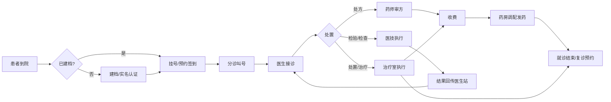
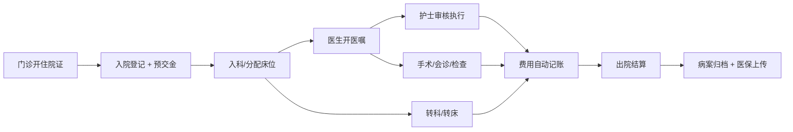

# HIS 系统功能需求文档（评审稿 v0.1）

| 项 | 内容 |
| --- | --- |
| 文档版本 | v0.1 评审稿 |
| 日期 | 2026-11-06 |
| 配套文档 | `01-架构方案.md` |
| 优先级定义 | P0 = 上线必需；P1 = 一期后补齐；P2 = 增强/智能化 |

---

## 1. 角色与权限矩阵

| 角色 | 主要使用场景 | 数据可见范围 |
| --- | --- | --- |
| 门诊医生 | 接诊、开医嘱、写病历 | 本人接诊患者、本科室历史就诊 |
| 住院医生 | 查房、开长期/临时医嘱、写病程 | 本人分管床位患者 |
| 护士（门诊/住院） | 分诊、执行医嘱、护理记录 | 本科室/本病区患者 |
| 收费员 | 挂号、收费、退费、日结 | 本窗口、本班次 |
| 药房药师 | 审方、调配、发药、退药 | 本药房 |
| 药库管理员 | 入库、出库、盘点、调价 | 全部药库数据 |
| 医技技师 | 接收申请、录结果、出报告 | 本科室申请单 |
| 病案管理员 | 病历质控、归档、借阅 | 全院已归档病历 |
| 医保专员 | 医保登记、结算、对账 | 医保相关单据 |
| 财务/统计 | 报表、收入分析 | 全院汇总（脱敏明细） |
| 系统管理员 | 用户、权限、参数、审计 | 配置数据，**不可查看病历正文** |
| 患者 | 自助机/公众号：挂号、缴费、查报告 | 仅本人数据 |

**权限模型**：RBAC（角色）+ 数据权限（科室/病区/患者归属）+ 操作权限（按钮级）+ 敏感操作二次确认（退费、病历修改、批量导出）。

---

## 2. 核心业务流程

### 2.1 门诊就诊全流程

**关键规则**
- 未缴费的处方不得发药；急诊可开启"先诊疗后付费"开关（按医院策略）。
- 退费必须原路退回，且校验"是否已发药/已执行检验"，已执行部分需走退药/退检流程。
- 一次挂号对应一次就诊流水号（`visit_id`），所有处方、申请单、费用均挂在 `visit_id` 下。

### 2.2 住院全流程

**关键规则**
- 床位是稀缺资源，分配/转床需加锁防重复占用。
- 长期医嘱按频次自动生成执行计划，停嘱需记录停嘱时间与执行人。
- 记账与医嘱执行解耦但可追溯：每条费用明细必须能反查到对应医嘱/执行记录。
- 出院前校验：未停医嘱、未结费用、未回报告、未归档病历 → 阻断并提示。

### 2.3 药品闭环

**关键规则**
- 库存以"批次 + 效期"为最小单元，近效期优先出库。
- 毒麻精药品单独管控：双人核对、专柜、专用处方、逐支登记。
- 抗菌药物分级管理：非限制/限制/特殊使用级，越级开立需审批。

---

## 3. 功能清单

> 优先级在"单人自研 + 三级医院 + 4 级评价"前提下重新校准：P0 为 M0–M2 必须交付；P1 为评级前补齐；P2 为评级后增强。

### M01 基础主数据管理

| 编号 | 功能点 | 优先级 | 说明 |
| --- | --- | --- | --- |
| M01-01 | 机构与院区管理 | P0 | 支持一院多区 |
| M01-02 | 科室/病区/诊室管理 | P0 | 树形结构，含科室属性（临床/医技/职能） |
| M01-03 | 人员与执业信息 | P0 | 医师执业证、职称、处方权、抗菌药物权限 |
| M01-04 | 角色与权限配置 | P0 | 菜单 + 按钮 + 数据范围 |
| M01-05 | 收费项目与价格版本 | P0 | 生效区间、历史价快照、医保对码 |
| M01-06 | 药品字典 | P0 | 通用名/商品名、规格、剂型、剂量单位、医保类别 |
| M01-07 | 诊疗项目字典 | P0 | 检查、检验、治疗、手术 |
| M01-08 | ICD-10 诊断 / ICD-9-CM3 手术编码 | P0 | 支持国家临床版与医保版双版本映射 |
| M01-09 | 通用字典（性别、民族、婚姻、付费方式等） | P0 | 国标字典优先 |
| M01-10 | 排班模板与号源规则 | P0 | 时段、号别（普通/专家/急诊）、限号 |
| M01-11 | 数据字典变更审计 | P1 | 变更留痕，价格调价需审批 |

### M02 患者服务

| 编号 | 功能点 | 优先级 | 说明 |
| --- | --- | --- | --- |
| M02-01 | 患者建档 | P0 | 身份证/就诊卡/护照/无主患者 |
| M02-02 | 患者主索引（EMPI） | P0 | 多卡合一，重复建档检测 |
| M02-03 | 患者合并与拆分 | P1 | 可回溯的 ID 映射，禁止物理删除 |
| M02-04 | 实名认证 | P1 | 对接公安/人脸核身（可配置） |
| M02-05 | 患者标签与过敏史 | P0 | 过敏史在开方时强提示 |
| M02-06 | 就诊历史时间轴 | P0 | 门急诊、住院、检验检查聚合展示 |

### M03 门诊挂号与预约

| 编号 | 功能点 | 优先级 | 说明 |
| --- | --- | --- | --- |
| M03-01 | 现场挂号（普通/专家/急诊） | P0 | 支持医保卡、就诊卡、身份证、电子健康卡 |
| M03-02 | 预约挂号（线上/电话/诊间） | P1 | 号源池统一，防超卖 |
| M03-03 | 签到与取号 | P0 | 超时未签到自动作废 |
| M03-04 | 退号与换号 | P0 | 退号释放号源，已接诊不可退 |
| M03-05 | 加号与特殊号 | P1 | 需权限审批 |
| M03-06 | 挂号费收取与减免 | P0 | 减免需审批留痕 |

### M04 门诊医生站

| 编号 | 功能点 | 优先级 | 说明 |
| --- | --- | --- | --- |
| M04-01 | 候诊队列与叫号接诊 | P0 | 按顺序 / 可"过号重排" |
| M04-02 | 患者概览（过敏史、既往史、用药史） | P0 | 首屏必看信息 |
| M04-03 | 电子处方（西药/中成药/草药） | P0 | 剂量、频次、疗程、用法校验 |
| M04-04 | 合理用药校验 | P1 | 相互作用、配伍禁忌、剂量上限、儿童/孕产妇禁忌 |
| M04-05 | 检验/检查申请单 | P0 | 带临床诊断与适应症 |
| M04-06 | 处置/治疗申请 | P0 | 门诊治疗、换药、注射 |
| M04-07 | 诊断录入（主诊断 + 次诊断） | P0 | 必填主诊断才能结束就诊 |
| M04-08 | 门诊病历（结构化模板） | P0 | 主诉、现病史、既往史、查体、处理意见 |
| M04-09 | 检验检查结果查看 | P0 | 图文报告、趋势对比 |
| M04-10 | 转诊/转科/开住院证 | P0 | 生成住院申请单 |
| M04-11 | 复诊预约 | P1 | 接诊结束自动推荐 |
| M04-12 | 模板与个人常用语 | P1 | 医生私有模板 |
| M04-13 | 危急值强提醒 | P0 | 弹窗 + 确认留痕 |

### M05 门诊收费

| 编号 | 功能点 | 优先级 | 说明 |
| --- | --- | --- | --- |
| M05-01 | 待收费列表（按就诊号合并） | P0 | 处方、检查、治疗合并结算 |
| M05-02 | 划价与优惠 | P0 | 优惠需权限与原因 |
| M05-03 | 多渠道支付 | P0 | 现金、银行卡、微信、支付宝、医保个账 |
| M05-04 | 发票开具与作废 | P0 | 电子发票 / 纸质票据号段管理 |
| M05-05 | 退费（部分/全额） | P0 | 原路退回，校验执行状态 |
| M05-06 | 预交金充值与退还 | P0 | 住院与门诊共用账户 |
| M05-07 | 收费员日结与交班 | P0 | 按支付方式分类汇总 + 长短款登记 |
| M05-08 | 支付渠道对账 | P1 | 每日自动比对，差异工单化 |
| M05-09 | 欠费与担保管理 | P2 | 绿色通道场景 |

### M06 分诊叫号

| 编号 | 功能点 | 优先级 | 说明 |
| --- | --- | --- | --- |
| M06-01 | 自动分诊（按科室/号别） | P0 | 规则可配 |
| M06-02 | 人工分诊与优先级调整 | P0 | 老人、儿童、急危重优先 |
| M06-03 | 叫号与屏显 | P0 | 语音合成 + 大屏 |
| M06-04 | 过号/重呼/跳号 | P0 | 留痕 |
| M06-05 | 候诊时长统计 | P1 | 用于服务质量管理 |

### M07 住院管理

| 编号 | 功能点 | 优先级 | 说明 |
| --- | --- | --- | --- |
| M07-01 | 入院登记 | P0 | 住院号生成、医保登记前置 |
| M07-02 | 预交金管理 | P0 | 充值、退款、余额预警 |
| M07-03 | 床位管理（可视化床位卡） | P0 | 空/占/锁/清洁 状态 |
| M07-04 | 入科、转科、转床 | P0 | 床位加锁，防并发占用 |
| M07-05 | 出院办理 | P0 | 出院带药、出院小结、结算前置校验 |
| M07-06 | 住院费用一日清单 | P0 | 患者每日费用明细，可自助查询 |
| M07-07 | 住院结算 | P0 | 医保/自费、补缴/退费 |
| M07-08 | 病案首页 | P0 | 诊断、手术、离院方式，供 DRG 使用 |
| M07-09 | 欠费出院与担保 | P1 | 需审批 |

### M08 住院医生站

| 编号 | 功能点 | 优先级 | 说明 |
| --- | --- | --- | --- |
| M08-01 | 分管患者列表（按床位/病情） | P0 | 危重标识 |
| M08-02 | 长期医嘱（药品/护理/监测/饮食） | P0 | 频次自动生成执行计划 |
| M08-03 | 临时医嘱 | P0 | 一次性执行 |
| M08-04 | 医嘱停用/作废/重整 | P0 | 留痕，已执行不可作废 |
| M08-05 | 医嘱套（临床路径模板） | P1 | 一键开立 |
| M08-06 | 病程记录（首次/日常/上级查房） | P0 | 结构化 + 模板 |
| M08-07 | 查房记录与三级医师签名 | P0 | 上级医师审核 |
| M08-08 | 会诊申请与回复 | P1 | 跨科会诊流程 |
| M08-09 | 手术申请与术前小结 | P0 | 对接手术麻醉 |
| M08-10 | 出院小结与诊断 | P0 | 出院带药、随访建议 |
| M08-11 | 检验检查结果查看与趋势 | P0 | 危急值提醒 |
| M08-12 | 临床路径管理 | P2 | 路径变异记录 |

### M09 住院护士站

| 编号 | 功能点 | 优先级 | 说明 |
| --- | --- | --- | --- |
| M09-01 | 床位一览（卡片式） | P0 | 护理等级、过敏、危重标识 |
| M09-02 | 医嘱审核与执行 | P0 | 扫码执行（患者腕带 + 药品条码） |
| M09-03 | 给药记录与执行签名 | P0 | 时间、剂量、执行人 |
| M09-04 | 输液与静配管理 | P1 | 输液卡、滴速、批次 |
| M09-05 | 生命体征录入 | P0 | 体温单自动绘制 |
| M09-06 | 护理记录单 | P0 | 结构化 + 模板 |
| M09-07 | 护理评估（跌倒/压疮/疼痛） | P1 | 评分与预警 |
| M09-08 | 交接班 | P0 | 按患者生成交班报告 |
| M09-09 | 手术患者转运与核对 | P0 | 术前核对清单 |
| M09-10 | 标本采集与条码打印 | P0 | 与 LIS 对接 |

### M10 药事管理

| 编号 | 功能点 | 优先级 | 说明 |
| --- | --- | --- | --- |
| M10-01 | 药品采购与入库 | P0 | 采购计划、到货验收、批次效期 |
| M10-02 | 药房请领与出库 | P0 | 库房 → 药房调拨 |
| M10-03 | 库存查询与预警 | P0 | 低库存、近效期、断货预警 |
| M10-04 | 处方/医嘱审核 | P0 | 药师审核，不合理处方退回 |
| M10-05 | 门诊调配与发药 | P0 | 排队叫号取药 |
| M10-06 | 住院摆药与发药 | P0 | 按病区/床位的单剂量摆药 |
| M10-07 | 退药 | P0 | 校验未使用、批号追溯 |
| M10-08 | 盘点与报损 | P0 | 盘盈盘亏、效期报损 |
| M10-09 | 药品调价 | P1 | 生效时间控制，历史不动 |
| M10-10 | 毒麻精药品管理 | P0 | 双人核对、专柜、逐支登记 |
| M10-11 | 抗菌药物分级管控 | P0 | 越级审批 |
| M10-12 | 静脉用药集中调配（PIVAS） | P2 | 静配中心流程 |
| M10-13 | 药品追溯码上传 | P1 | 对接国家药品追溯平台 |

### M11 医技管理（厂商未定，Mock 先行）

> LIS / PACS 厂商尚未确定：先按 `IntegrationPort` 契约开发，Mock 服务返回仿真结果；厂商确定后只替换 Adapter，不改业务代码。若厂商迟迟未定，保留手工录入与报告上传作为兜底，确保门诊住院闭环不被阻塞。

| 编号 | 功能点 | 优先级 | 说明 |
| --- | --- | --- | --- |
| M11-01 | 检验申请接收与条码 | P0 | 与 LIS 双向对接 |
| M11-02 | 标本流转与状态跟踪 | P0 | 已采集/已接收/已上机/已审核 |
| M11-03 | 检验结果回传与报告 | P0 | 结构化结果 + PDF 报告 |
| M11-04 | 危急值上报与闭环 | P0 | 通知医生并记录确认 |
| M11-05 | 影像申请与预约 | P0 | RIS 排期，PACS 取图 |
| M11-06 | 影像报告书写与审核 | P0 | 双签名（书写 + 审核） |
| M11-07 | 心电/内镜/超声报告 | P1 | 图文报告 |
| M11-08 | 报告打印与补打 | P0 | 打印次数留痕 |
| M11-09 | 医技计费 | P0 | 执行即记账 |

### M12 电子病历（详细设计见 `05-电子病历评价模块设计.md`）

| 编号 | 功能点 | 优先级 | 说明 |
| --- | --- | --- | --- |
| M12-01 | 结构化病历编辑器 | P0 | 支持模板、元素、单选/多选/文本 |
| M12-02 | 病历模板库（院级/科室/个人） | P0 | 版本管理 |
| M12-03 | 病历书写时限监控 | P0 | 入院记录 24h、首次病程 8h 等 |
| M12-04 | 病历质控（形式 + 内涵） | P1 | 自动规则 + 人工抽查 |
| M12-05 | 电子签名 | P0 | CA 签名，签名后锁定 |
| M12-06 | 病历修改留痕与版本对比 | P0 | 只增不改，差异可查 |
| M12-07 | 病历借阅与复印申请 | P0 | 审批 + 留痕 |
| M12-08 | 病历归档与封存 | P0 | 归档后只读 |
| M12-09 | 病历封存与解封 | P1 | 司法场景，严格审计 |
| M12-10 | 智能质控/AI 辅助书写 | P2 | 见 P5 阶段 |

### M13 医保管理（本地统筹区适配）

> 医保为本地统筹区接口，地方差异大：所有结算逻辑经"地方适配层"，按统筹区实现 Adapter；每次调用保存请求/响应报文快照（`JSONB`），用于对账与追溯。接口文档与前置机需尽早向当地医保局索取。

| 编号 | 功能点 | 优先级 | 说明 |
| --- | --- | --- | --- |
| M13-01 | 医保患者登记 | P0 | 读卡、身份核验 |
| M13-02 | 医保目录维护与对码 | P0 | 药品/诊疗/耗材三目录 |
| M13-03 | 门诊医保结算 | P0 | 统筹、个账、大病 |
| M13-04 | 住院医保预结算 | P0 | 中途结算、预结算试算 |
| M13-05 | 出院医保结算 | P0 | 生成结算单与发票 |
| M13-06 | 医保退费与冲正 | P0 | 与本地账单联动 |
| M13-07 | 医保上传与对账 | P0 | 日对账、差异处理 |
| M13-08 | DRG/DIP 预分组 | P1 | 病案首页入组试算 |
| M13-09 | 特病/慢病/门诊统筹 | P1 | 按地方政策适配 |
| M13-10 | 异地就医结算 | P1 | 跨省/省内异地 |

### M14 报表与决策分析

| 编号 | 功能点 | 优先级 | 说明 |
| --- | --- | --- | --- |
| M14-01 | 门急诊量日报/月报 | P0 | 按科室、医生、号别 |
| M14-02 | 收入报表 | P0 | 医疗收入、药品收入、药占比 |
| M14-03 | 工作量统计 | P0 | 医师工作量、医技工作量 |
| M14-04 | 床位使用与周转 | P0 | 使用率、平均住院日 |
| M14-05 | 药品消耗与库存分析 | P1 | 抗菌药物使用强度 |
| M14-06 | 医保结算分析 | P1 | 统筹支付、拒付原因 |
| M14-07 | 自定义报表工具 | P2 | 拖拽式取数（受限白名单表） |
| M14-08 | 大屏驾驶舱 | P2 | 实时业务看板 |

### M15 系统管理

| 编号 | 功能点 | 优先级 | 说明 |
| --- | --- | --- | --- |
| M15-01 | 用户管理 | P0 | 启用/停用、密码策略 |
| M15-02 | 角色与菜单权限 | P0 | 按钮级 |
| M15-03 | 数据权限配置 | P0 | 科室/病区/本人 |
| M15-04 | 操作审计日志 | P0 | 查询、导出、留存 ≥6 个月 |
| M15-05 | 登录日志与异常登录告警 | P0 | 异地/异常时段 |
| M15-06 | 系统参数配置 | P0 | 分环境、可热更新 |
| M15-07 | 接口监控与重试 | P1 | 医保/LIS 调用成功率 |
| M15-08 | 定时任务管理 | P1 | 对账、归档、报表生成 |
| M15-09 | 数据备份与恢复入口 | P1 | 仅运维角色 |

### M16 对外服务（整体 P2，评级后再建设）

| 编号 | 功能点 | 优先级 | 说明 |
| --- | --- | --- | --- |
| M16-01 | 自助机：挂号/缴费/打印 | P1 | 与收费共用一套交易接口 |
| M16-02 | 公众号/小程序：预约、缴费、报告 | P1 | 需实名绑定 |
| M16-03 | 报告查询与下载 | P1 | 脱敏、限时有效链接 |
| M16-04 | 排队进度查询 | P2 | 分诊数据只读 |
| M16-05 | 电子票据 | P1 | 对接财政电子票据平台 |

---

## 4. 核心数据实体（主要表）

| 域 | 主要实体 |
| --- | --- |
| 组织人员 | `org`、`dept`、`ward`、`employee`、`role`、`permission`、`data_scope` |
| 患者 | `patient`、`patient_card`、`patient_visit`、`patient_merge_log`、`patient_allergy` |
| 挂号 | `schedule`、`schedule_slot`、`registration`、`queue_ticket` |
| 门诊 | `outpatient_order`、`prescription`、`prescription_item`、`exam_apply`、`lab_apply` |
| 收费 | `charge_item`、`price_version`、`bill`、`bill_item`、`payment`、`refund`、`invoice` |
| 住院 | `admission`、`bed`、`bed_assign_log`、`transfer_log`、`deposit`、`discharge` |
| 医嘱 | `medical_order`、`order_execution`、`order_stop_log` |
| 药事 | `drug`、`drug_stock_batch`、`drug_inout`、`dispense_record`、`drug_inventory_check` |
| 医技 | `lab_order`、`lab_result`、`exam_order`、`exam_report`、`critical_value` |
| EMR | `emr_document`、`emr_template`、`emr_version`、`emr_sign`、`emr_access_log` |
| 医保 | `ins_registration`、`ins_settlement`、`ins_upload_log`、`ins_reconcile` |
| 审计 | `audit_log`、`login_log`、`export_log`、`outbox_event` |

**共性设计约定**
- 所有业务表包含：`id`、`created_by`、`created_at`、`updated_by`、`updated_at`、`version`（乐观锁）、`deleted`（逻辑删除）；
- 金额统一用 `numeric(14,2)`，禁止浮点；
- 关键单据冗余快照字段（患者姓名、价格、科室名），避免历史单据随主数据变化而失真。

---

## 5. 电子病历应用水平 4 级能力映射

> 本章为概要映射。病历文档、质控、CDR、决策支持、闭环、签名、归档的详细设计见 [`05-电子病历评价模块设计.md`](05-电子病历评价模块设计.md)。

> 三级医院通常要求 4 级以上。4 级的核心是**全院信息共享 + 中级医疗决策支持**。下表按能力域列出必须交付的功能，可作为评级前的自评清单（具体条款以国家卫健委最新评价标准为准）。

| 能力域 | 4 级要求（能力描述） | 对应功能点 | 状态 |
| --- | --- | --- | --- |
| 病房医嘱处理 | 长期/临时医嘱全流程闭环，可追溯执行人与时间 | M08、M09、M10 | 必须 |
| 门诊就诊信息 | 挂号、接诊、处方、申请、收费、发药信息全院共享 | M03–M05、M10 | 必须 |
| 检查检验信息 | 申请、标本、结果、报告全流程可查，门诊/住院均可调阅 | M11 | 接口对接（厂商未定，Mock 先行） |
| 病历书写 | 结构化病历、模板、时限控制、修改留痕 | M12-01~03、M12-06 | 必须 |
| 身份认证与电子签名 | 医护身份唯一标识，签名后病历锁定 | M12-05、M15-01 | 必须 |
| 数据整合（CDR） | 以患者为中心整合门诊、住院、检验、检查、用药数据 | 患者全流程视图 | **需补建** |
| 医疗决策支持 | 药品知识库、合理用药审查、检验检查知识库、临床路径 | M04-04、M08-12、M10-11 | **需补建** |
| 闭环管理 | 医嘱、处方、检验、用血、手术等关键环节闭环并统计闭环率 | M08、M09、M11 | 必须 |
| 病历质控 | 形式质控 + 内涵质控 + 质控记录 | M12-04 | 必须 |
| 数据安全与灾备 | 操作留痕、备份恢复、故障演练 | 见 `01-架构方案.md` 第 8 节 | 必须 |

### 5.1 单人项目最容易漏掉的三项

1. **CDR 患者全流程视图**：把门诊、住院、检验、检查、用药按时间轴聚合到一个页面。这是"信息共享"的展示载体，没有它，功能再多也过不了。
2. **药品知识库 + 合理用药引擎**：至少覆盖相互作用、配伍禁忌、剂量范围、特殊人群禁忌。可先用规则库 + 药品说明书结构化数据，不必上 AI。
3. **临床路径**：至少 5–10 个常见病种的路径模板，并能记录变异。

> 这三项在原始 16 模块清单里权重被低估，但对 4 级是硬要求，已纳入 M3–M4 里程碑。

> **"上线即迎评"的排期要求**：上述三项不能等到上线后再补。CDR 与合理用药、临床路径的最小可用版本必须与核心闭环同期交付，否则现场评审拿不出使用数据。

---

## 6. 验收要点（供评审）

1. **账务准确性**：日结金额 = 支付渠道流水 = 医保结算金额，三方对平。
2. **库存准确性**：系统库存 = 实盘库存，差异可追溯至具体流水。
3. **闭环完整性**：每条医嘱可从开立追踪到执行/发药/计费。
4. **病历合规性**：修改留痕、签名有效、归档后不可改。
5. **性能达标**：见 `01-架构方案.md` 第 7 节指标。
6. **安全合规**：等保三级自查表全部通过。
7. **评级就绪**：第 5 节能力域全部有对应功能，且有真实使用数据与闭环率统计。
