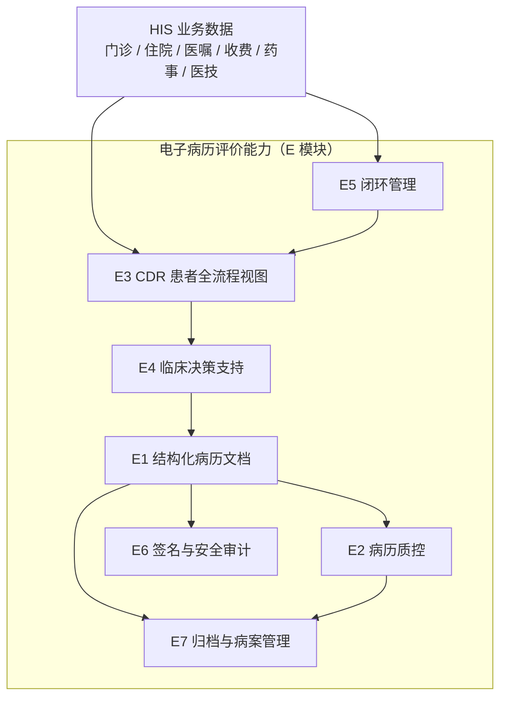

# 电子病历评价模块设计（评审稿 v0.1）

| 项 | 内容 |
| --- | --- |
| 文档版本 | v0.1 评审稿 |
| 日期 | 2026-11-06 |
| 目标 | 电子病历应用水平分级评价 4 级 |
| 前提 | 三级医院、300–500 床、1 人自研、上线即迎评 |
| 配套文档 | `01-架构方案.md`、`02-功能需求文档.md` |

---

## 1. 评价目标与设计原则

### 1.1 4 级的实质要求

4 级的两条主线是**全院信息共享**与**中级医疗决策支持**。落到系统上，不是"有没有病历编辑器"，而是：

1. 门诊、住院、医技、药房的数据能在一个患者视图里被完整调阅；
2. 医嘱、处方、检验、检查等关键环节**闭环可追溯**；
3. 开立环节有**知识库驱动的实时提醒**（合理用药、检验检查适应症）；
4. 病历**结构化、有时限、有质控、有签名、有留痕**；
5. 以上都有**真实使用数据**可举证。

> 评审查的是"应用水平"，不是"功能清单"。同样的功能，使用率 10% 和使用率 90% 是两个结论。

### 1.2 设计原则

| 原则 | 说明 |
| --- | --- |
| 结构化优先，自由文本兜底 | 核心字段结构化（可质控、可统计），叙述部分保留自由文本 |
| 只增不改 | 病历修改生成新版本，签名后锁定，任何变更可追溯 |
| 规则可配置 | 质控规则、CDSS 规则做成规则表，不写死在代码里 |
| 证据可举证 | 每个评级能力域都要有对应的查询页面与统计报表，评审现场能当场演示 |
| 单人可维护 | 不引入规则引擎中间件、不引入独立数仓；用数据库表 + 轻量规则匹配实现 |

---

## 2. 模块总览



| 模块 | 承担的评级能力域 | 首版是否必需 |
| --- | --- | --- |
| E1 结构化病历文档 | 病历书写、门诊/住院信息共享 | 必需 |
| E2 病历质控 | 病历质控、时限管理 | 必需（形式质控） |
| E3 CDR 全流程视图 | 数据整合、全院信息共享 | 必需（最小版） |
| E4 临床决策支持 | 中级医疗决策支持 | 必需（最小规则集） |
| E5 闭环管理 | 闭环管理、闭环率 | 必需（基础闭环） |
| E6 签名与安全审计 | 身份认证、电子签名、留痕 | 必需 |
| E7 归档与病案管理 | 病历归档、病案首页 | 评级前必需 |

---

## 3. E1 结构化病历文档

### 3.1 功能设计

| 编号 | 功能 | 说明 |
| --- | --- | --- |
| E1-01 | 病历文书类型管理 | 门诊病历、入院记录、首次病程、日常病程、查房记录、术前小结、手术记录、术后首次病程、出院记录、死亡记录、护理记录、知情同意书 |
| E1-02 | 结构化模板 | 模板由"段落 + 元素"组成，元素类型：文本、数字、日期、单选、多选、诊断引用、药品引用、检验引用 |
| E1-03 | 模板作用域 | 院级 / 科室级 / 个人级；模板带版本号，病历引用创建时的版本，模板升级不影响历史病历 |
| E1-04 | 混合编辑 | 结构化元素 + 自由文本段落并存；支持"上一份病历带入"减少重复录入 |
| E1-05 | 诊断与手术引用 | 诊断从 ICD-10 选择，手术从 ICD-9-CM3 选择，禁止手填编码 |
| E1-06 | 时限提醒 | 按文书类型计算截止时间，超时进入待办与预警 |
| E1-07 | 版本与差异 | 每次保存生成版本；支持两版本差异对比（按段落高亮） |
| E1-08 | 打印与导出 | 套打模板、PDF 导出；打印次数留痕 |
| E1-09 | 复制与模板套用 | 同病种/同科室模板一键生成草稿 |

### 3.2 数据模型

| 表 | 关键字段 | 说明 |
| --- | --- | --- |
| `emr_document` | `id`、`patient_id`、`visit_id`、`doc_type`、`template_id`、`template_version`、`status`、`author_id`、`signed_at`、`archived_at`、`content jsonb` | 主表，`content` 存整份结构化内容 |
| `emr_template` | `id`、`doc_type`、`scope`、`dept_id`、`version`、`schema jsonb`、`status` | 模板定义与版本 |
| `emr_version` | `doc_id`、`version_no`、`content jsonb`、`change_summary`、`changed_by`、`changed_at` | 每次保存一版，只增不改 |
| `emr_sign` | `doc_id`、`version_no`、`signer_id`、`sign_type`、`cert_sn`、`content_hash`、`signed_at` | 签名记录 |
| `emr_access_log` | `doc_id`、`operator_id`、`action`、`reason`、`ip`、`created_at` | 调阅、打印、导出留痕 |

**存储约定**：`content` 用 JSONB，按段落组织：

```json
{
  "sections": [
    {"code": "chief_complaint", "title": "主诉", "type": "text", "value": "..."},
    {"code": "present_illness", "title": "现病史", "type": "text", "value": "..."},
    {"code": "diagnosis", "title": "诊断", "type": "icd", "value": [{"code": "J18.9", "name": "肺炎"}]}
  ]
}
```

### 3.3 病历时限规则（按《病历书写基本规范》，以医院制度为准）

| 文书 | 时限 |
| --- | --- |
| 入院记录 | 入院后 24 小时内 |
| 首次病程记录 | 入院后 8 小时内 |
| 日常病程记录 | 病危每日至少 1 次；病重至少 2 天 1 次；病情稳定至少 3 天 1 次 |
| 主治医师首次查房记录 | 入院后 48 小时内 |
| 手术记录 | 术后 24 小时内 |
| 术后首次病程记录 | 术后即时完成 |
| 出院记录 | 出院后 24 小时内 |

实现方式：定时任务（每 15 分钟）扫描未完成文书，按 `deadline` 生成待办与超时预警，预警推送至医生站待办中心。

---

## 4. E2 病历质控

### 4.1 三级质控体系

| 层级 | 责任人 | 内容 |
| --- | --- | --- |
| 一级：科室自查 | 书写医生 + 科室质控员 | 提交前自动检查，缺陷提示 |
| 二级：院级抽查 | 病案室 | 按比例抽查，记录缺陷与整改 |
| 三级：终末质控 | 病案室 | 归档前全量检查，未通过不退档 |

### 4.2 功能设计

| 编号 | 功能 | 说明 |
| --- | --- | --- |
| E2-01 | 形式质控 | 必填项、时限、签名、诊断完整性、手术记录匹配 |
| E2-02 | 内涵质控 | 主诊断与病程一致性、用药与诊断相符、手术与麻醉记录匹配、病程记录连续性 |
| E2-03 | 规则配置 | 规则表可启停、可调严重级别（阻断/警告/提示） |
| E2-04 | 缺陷清单与整改 | 缺陷分配到医生，医生整改后复核关闭 |
| E2-05 | 质控评分 | 按文书类型计算得分，形成科室/医生质控报表 |
| E2-06 | 质控留痕 | 缺陷、整改、复核全过程留痕，供评审举证 |
| E2-07 | 归档拦截 | 存在阻断级缺陷时禁止归档 |

### 4.3 规则模型

| 表 | 关键字段 |
| --- | --- |
| `emr_qc_rule` | `rule_code`、`category`（form/content）、`severity`、`doc_type`、`check_expr`、`enabled`、`version` |
| `emr_qc_task` | `doc_id`、`rule_code`、`result`、`defect_desc`、`status`、`assignee_id`、`closed_at` |
| `emr_qc_score` | `doc_id`、`dept_id`、`doctor_id`、`score`、`period` |

**实现取舍**：单人项目**不引入 Drools**。规则用"规则元数据 + Java 校验器"实现——每类规则一个校验器（如必填校验、时限校验、诊断一致性校验），规则表只控制启用与严重级别。这样规则可配置，但不需要维护规则 DSL。

---

## 5. E3 CDR 患者全流程视图

### 5.1 功能设计

| 编号 | 功能 | 说明 |
| --- | --- | --- |
| E3-01 | 患者时间轴 | 按时间倒序聚合门诊、住院、急诊、检验、检查、用药、手术、护理事件 |
| E3-02 | 就诊详情 | 单次就诊的诊断、医嘱、处方、报告、费用一页展示 |
| E3-03 | 趋势图 | 检验指标趋势（如血常规、肝肾功能）、生命体征趋势 |
| E3-04 | 跨科调阅 | 授权范围内跨科室调阅，记录调阅原因 |
| E3-05 | 过敏与警示 | 过敏史、传染病、危急值在视图顶部强提示 |
| E3-06 | 数据来源标识 | 每条数据标注来源系统与时间，避免"来源不明" |

### 5.2 实现方式（不建独立数仓）

| 层 | 做法 |
| --- | --- |
| 实时视图 | 直接查业务库/只读从库，按 `patient_id` 聚合，单患者数据量可控 |
| 预聚合 | 对高频页面（患者概览）建物化视图或定时汇总表，避免每次多表联查 |
| 索引 | `patient_visit(patient_id, visit_time)`、`medical_order(patient_id, order_time)` 等联合索引 |
| 缓存 | 患者概览页缓存 30–60 秒，减少重复查询 |

> 单人项目不要建独立 CDR 库：数据同步、一致性、运维都是额外负担。4 级要的是"能共享调阅"，不是"必须有数据仓库"。

---

## 6. E4 临床决策支持（中级）

### 6.1 能力范围

| 编号 | 功能 | 说明 |
| --- | --- | --- |
| E4-01 | 药品知识库 | 适应症、禁忌症、用法用量、相互作用、特殊人群（儿童/孕妇/肝肾功能不全） |
| E4-02 | 处方实时审查 | 开立时同步校验：诊断禁忌、重复用药、相互作用、剂量范围、抗菌药物分级 |
| E4-03 | 检验检查知识库 | 项目适应症、标本要求、参考范围、危急值阈值 |
| E4-04 | 危急值闭环 | 结果触发 → 通知医生 → 确认 → 记录处理措施 |
| E4-05 | 临床路径 | 病种路径模板、入径/变异/退出、路径执行率统计 |
| E4-06 | 提醒分级 | 阻断（不可开立）/ 强提醒（需填理由）/ 提示（可忽略） |
| E4-07 | 忽略留痕 | 医生忽略强提醒必须填写理由，供质控与评审举证 |

### 6.2 数据模型

| 表 | 说明 |
| --- | --- |
| `drug_knowledge` | 药品说明书结构化：适应症、禁忌、剂量、特殊人群 |
| `drug_interaction` | 药品-药品相互作用，含严重级别与机制说明 |
| `cdss_rule` | 规则：条件表达式 + 提示内容 + 级别 + 引用知识条目 |
| `cdss_alert_log` | 触发记录：患者、规则、医生、处理结果（接受/忽略+理由） |
| `clinical_pathway` / `pathway_node` / `pathway_variance` | 路径模板、节点、变异记录 |

### 6.3 单人可落地的最小知识库

不做全量药品知识库，先覆盖**高频 200–300 个药品 + 20 个高频检验项目**，足以支撑现场演示与日常使用：

1. 药品说明书结构化（可从国家药监局说明书数据库整理）；
2. 相互作用先做高风险组合（如抗凝+抗血小板、他汀+大环内酯、地高辛+利尿剂）；
3. 剂量规则优先做特殊人群（儿童按体重、肾功能不全按 eGFR 调整）；
4. 临床路径先做 5–10 个常见病种（如肺炎、脑梗、剖宫产、胆囊结石）。

> 评审关注"有没有知识库驱动的提醒并能举证"，不要求知识库覆盖全部药品。

### 6.4 性能约束

合理用药审查在开立链路上同步执行，必须 **P95 ≤ 100 ms**：规则预加载到内存 + 按药品/诊断建索引，禁止每次查库全表扫描。

---

## 7. E5 闭环管理

### 7.1 闭环清单

| 闭环 | 节点链 |
| --- | --- |
| 医嘱闭环 | 开立 → 审核 → 执行 → 计费 |
| 处方闭环 | 开立 → 审方 → 收费 → 调配 → 发药 |
| 检验闭环 | 申请 → 收费 → 采样 → 接收 → 上机 → 审核 → 报告 → 医生调阅 |
| 检查闭环 | 申请 → 收费 → 预约 → 检查 → 报告 → 医生调阅 |
| 手术闭环 | 申请 → 审批 → 排期 → 术前核对 → 手术 → 术后记录 → 计费 |
| 用血闭环 | 申请 → 配血 → 发血 → 输注 → 输注记录 |

### 7.2 设计

统一用"业务单号 + 节点事件"建模：

| 表 | 关键字段 |
| --- | --- |
| `loop_instance` | `biz_no`、`loop_type`、`patient_id`、`status`、`started_at`、`closed_at` |
| `loop_node_event` | `loop_id`、`node_code`、`operator_id`、`dept_id`、`occurred_at`、`payload jsonb` |

**闭环率口径**（必须在系统内固化，避免评审时口径不一致）：

```
闭环率 = 节点链完整且按序完成的单据数 / 同期应闭环单据总数 × 100%
```

按科室、医生、单据类型出报表；未闭环单据进入待办，超过阈值预警。

---

## 8. E6 签名与安全审计

| 编号 | 功能 | 说明 |
| --- | --- | --- |
| E6-01 | 医护身份唯一标识 | 与人员主数据绑定，账号唯一，禁用即失效 |
| E6-02 | 电子签名 | 通过 HTTP 签名服务（CA/SM2），签名内容为规范化 JSON 的哈希 |
| E6-03 | 签名后锁定 | 已签名文书不可直接编辑，需"解锁申请"并留痕 |
| E6-04 | 验签 | 提供验签入口，评审可现场验证签名有效性 |
| E6-05 | 修改留痕与版本对比 | 所有修改生成版本，可查看差异 |
| E6-06 | 调阅审计 | 谁、何时、为何调阅/打印/导出，全部记录 |
| E6-07 | 封存与解封 | 司法场景封存，解封需审批 |

**实现要点**：签名服务用 `SignaturePort` 抽象，测试环境用自签证书，生产接医院 CA。签名哈希基于规范化后的结构化内容 + 版本号 + 时间戳，保证可复验。

---

## 9. E7 归档与病案管理

| 编号 | 功能 | 说明 |
| --- | --- | --- |
| E7-01 | 病案首页 | 诊断、手术、麻醉、离院方式、费用归类，供 DRG 使用 |
| E7-02 | 归档 | 归档时生成结构化快照 + PDF/A，归档后只读 |
| E7-03 | 归档校验 | 未完成文书、未签名、阻断级缺陷、未结费用 → 禁止归档 |
| E7-04 | 借阅与复印 | 申请 → 审批 → 借阅/复印 → 留痕，限时有效 |
| E7-05 | 病案编码 | ICD-10 / ICD-9-CM3 编码与核对 |
| E7-06 | 病案检索 | 按患者、科室、诊断、时间检索，权限受控 |
| E7-07 | 保存期限 | 门诊 ≥15 年、住院 ≥30 年，不物理删除 |

---

## 10. 评级自评清单（评审现场可举证）

| 能力域 | 功能证据 | 数据证据 | 制度证据 |
| --- | --- | --- | --- |
| 病房医嘱处理 | E5 医嘱闭环、E3 视图 | 闭环率报表、执行记录 | 医嘱管理制度 |
| 门诊信息共享 | E3 时间轴、E1 门诊病历 | 门诊病历完成率 | 门诊病历规范 |
| 检查检验共享 | E3 报告调阅、E5 检验闭环 | 报告调阅率、危急值处理记录 | 检验检查管理制度 |
| 病历书写 | E1 模板与结构化 | 各文书完成率、超时率 | 病历书写制度 |
| 身份与签名 | E6 签名、验签 | 签名覆盖率 | CA 管理制度 |
| 数据整合 (CDR) | E3 患者全流程视图 | 视图访问量 | — |
| 决策支持 | E4 合理用药、知识库、路径 | 提醒触发/采纳率、路径入径率 | 合理用药制度 |
| 闭环管理 | E5 六类闭环 | 各闭环闭环率 | 闭环管理制度 |
| 病历质控 | E2 三级质控 | 质控评分、缺陷整改率 | 质控管理制度 |
| 安全与灾备 | 审计、备份 | 审计查询、恢复演练记录 | 等保与灾备制度 |

> 这张表建议直接做成系统内的"评级自评"页面，每项显示当前数值与趋势，评审时可当场打开。

---

## 11. 首版最小可用集（上线即迎评）

| 优先级 | 内容 | 说明 |
| --- | --- | --- |
| **首版必须** | E1 常用文书（门诊病历、入院记录、首次病程、日常病程、出院记录）+ 模板 | 先覆盖 80% 使用场景，不追求全文书类型 |
| **首版必须** | E2 形式质控（必填、时限、签名、诊断完整性） | 内涵质控可后置，但形式质控必须首版有 |
| **首版必须** | E3 患者时间轴（门诊 + 住院 + 检验 + 检查 + 用药） | 最小版即可，先保证能聚合调阅 |
| **首版必须** | E4 合理用药最小规则集（禁忌、重复用药、相互作用、儿童/肾功能剂量）+ 危急值 | 200–300 个高频药品 |
| **首版必须** | E5 医嘱、处方、检验、检查四条闭环 + 闭环率报表 | 手术/用血闭环可稍后 |
| **首版必须** | E6 签名、版本、调阅审计 | CA 可先用测试证书 |
| **评级前补齐** | E4 临床路径（5–10 病种）、检验检查知识库 | 4 级需要中级决策支持 |
| **评级前补齐** | E7 归档、病案首页、借阅复印 | 归档是评审必查 |
| **可后置** | E2 内涵质控、E4 全量知识库、AI 质控 | 不影响 4 级结论 |

---

## 12. 关键难点与取舍

| 难点 | 取舍 |
| --- | --- |
| 医生抵触结构化录入 | 结构化只做核心字段，叙述部分自由文本；支持"带入上次病历"+ 语音/模板 |
| 质控规则噪声大 | 先做形式质控，规则分级；内涵质控用规则命中率持续调优，避免全员告警 |
| CDR 查询慢 | 单患者聚合 + 联合索引 + 概览缓存；不建独立数仓 |
| 知识库数据来源 | 先做高频药品与检验项目，说明书结构化，逐步扩充；不追求全量 |
| 签名依赖厂商 | `SignaturePort` 抽象 + 测试证书先行，生产替换实现 |
| 闭环口径不一致 | 统一 `loop_instance` + `loop_node_event` 模型，口径写进系统报表定义 |
| 单人维护规则 | 规则表 + Java 校验器，不引入 Drools；每条规则有明确责任人与启停开关 |

---

## 13. 待确认

1. 医院是否已有电子病历系统在用？若有，是替换还是共存（决定数据迁移量）。
2. CA 签名厂商与证书类型（是否支持 SM2）？
3. 临床路径由医务科提供病种清单，还是需要系统内置推荐？
4. 病案首页是否需对接 DRG/DIP 分组器（本地医保）？
